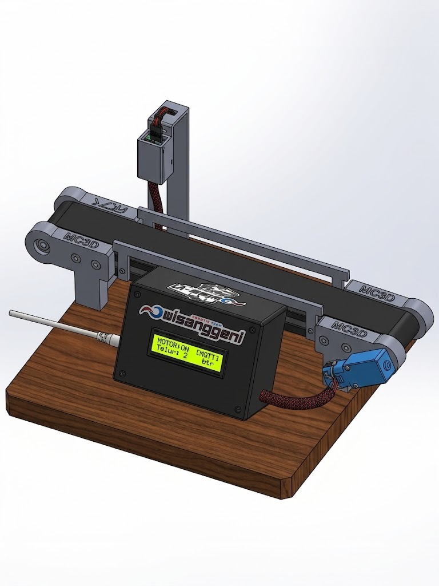
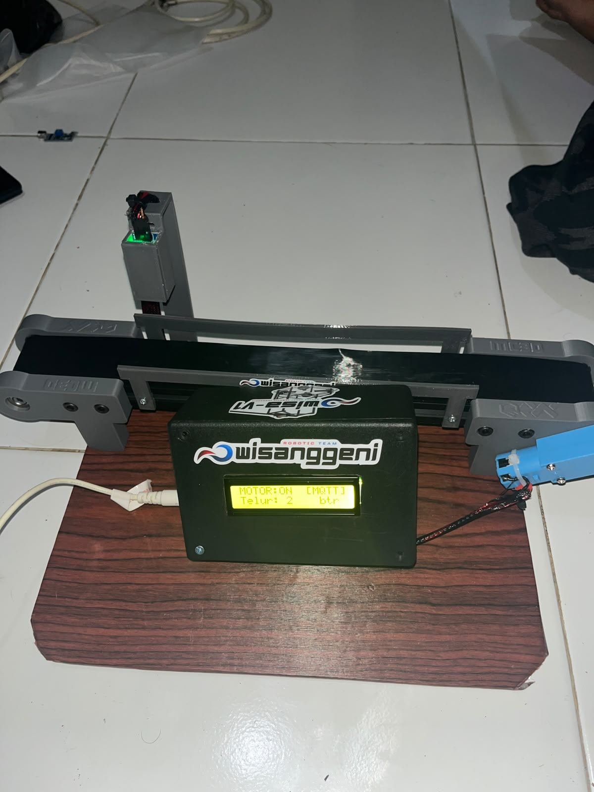

<div align="center">

# 🥚 Fian's Farm — Smart IoT Egg Conveyor & AI Ecosystem
### *End-to-End Smart Agriculture: Automated Optical Sorting, Real-Time Cloud Inventory, and Conversational AI Voice Assistant*

[](https://fiansfarm.vercel.app)
[](https://fiansfarm-production.up.railway.app)
[](#-hardware-architecture--wiring)
[](#-project-background--credits)

<p align="center">
  <strong>Proyek Inovasi Digitalisasi Rantai Pasok Peternakan Ayam Kampung Tradisional Menuju Industri Peternakan 4.0</strong><br>
  <em>Kolaborasi Akademik Manajemen Inovasi &ndash; Universitas Negeri Malang bersama Mitra Peternak Ayam Kampung Pasuruan, Jawa Timur.</em>
</p>

---

</div>

## 📌 Daftar Isi
1. [Ringkasan Eksekutif & Latar Belakang](#-ringkasan-eksekutif--latar-belakang)
2. [Desain CAD 3D vs Realisasi Perangkat Keras](#-desain-cad-3d-vs-realisasi-perangkat-keras)
3. [Arsitektur Ekosistem Sistem](#-arsitektur-ekosistem-sistem)
4. [Spesifikasi Perangkat Keras & Skema Perkabelan](#-spesifikasi-perangkat-keras--skema-perkabelan)
5. [Fitur Unggulan Sistem](#-fitur-unggulan-sistem)
6. [Struktur Repositori Monorepo](#-struktur-repositori-monorepo)
7. [Panduan Instalasi & Menjalankan Sistem](#-panduan-instalasi--menjalankan-sistem)
8. [Keamanan & Mekanisme Whitelist](#-keamanan--mekanisme-whitelist)
9. [Kontributor & Lisensi](#-kontributor--lisensi)

---

## 📖 Ringkasan Eksekutif & Latar Belakang

Di peternakan ayam kampung tradisional seperti **Fian's Farm** (Pasuruan, Jawa Timur), pencatatan panen telur dan pengelolaan inventaris selama ini masih dilakukan secara manual menggunakan buku catatan fisik. Metode konvensional ini memiliki sejumlah kelemahan kritis:
* ⚠️ **Kesalahan Penghitungan Manual:** Risiko telur terlewat atau dobel hitung saat proses sortir.
* ⚠️ **Telur Retak / Pecah Tidak Terlacak:** Kesulitan memantau susut stok antara telur di kandang dan stok siap jual.
* ⚠️ **Asimetri Informasi Stok:** Konsumen e-commerce atau pembeli langsung di peternakan sering menerima informasi stok yang tidak akurat (*out-of-stock* mendadak).
* ⚠️ **Beban Operasional Peternak:** Peternak harus membagi fokus antara pekerjaan fisik di kandang dengan melayani chat pemesanan pelanggan.

### 💡 Solusi Inovasi: Fian's Farm IoT Ecosystem
Proyek ini mengintegrasikan **teknologi mekatronika (IoT Conveyor)**, **Edge Computing (Node-RED Gateway)**, **Cloud Database Real-time (Supabase)**, **E-Commerce Web D2C (React + Vercel)**, dan **Kecerdasan Buatan (Google Gemini 3.5 via WhatsApp Bot)** ke dalam satu ekosistem terpadu yang bekerja secara otomatis 24/7.

```
[ Sensor IR + Conveyor ] ➡️ (MQTT) ➡️ [ Node-RED Gateway ] ➡️ (REST API) ➡️ [ Supabase Cloud ]
                                                                                   ↕️
[ Pelanggan & Konsumen ] ⬅️ (Live Sync) ⬅️ [ Vercel E-Commerce ]                    ↕️
[ Mitra Peternak / Owner] ⬅️ (Voice & Text) ⬅️ [ WhatsApp AI Bot (Gemini 3.5) ] ⬅️---
```

---

## 🎨 Desain CAD 3D vs Realisasi Perangkat Keras

Perangkat conveyor disimulasikan dan dirancang terlebih dahulu menggunakan pemodelan 3D CAD (*SolidWorks / Computer-Aided Design*) dengan mempertimbangkan ergonomi peternakan, jalur jatuh telur yang aman, pelindung samping (*guardrails*), dudukan menara optik sensor IR vertikal, serta kotak kontrol tertutup untuk modul elektronik.

| 🖥️ Desain Konseptual 3D CAD | 🛠️ Realisasi Perangkat Keras Fisik |
| :---: | :---: |
|  |  |
| *Rancangan digital 3D dengan sasis kustom MC3D, menara sensor optik, dan panel display.* | *Implementasi fisik prototipe operasional dengan sasis kayu, belt conveyor, LCD 16x2, dan ESP32.* |

> [!TIP]
> **File 3D & Desain Mekanikal:** File desain 3D STL/STEP untuk cetak 3D (*3D Printing*) braket conveyor dan menara sensor dapat diletakkan pada direktori [`docs/cad/`](docs/cad/).

---

## 🏗️ Arsitektur Ekosistem Sistem

Ekosistem Fian's Farm dibangun dengan arsitektur modular multi-tier yang tangguh dan andal:

```mermaid
flowchart TD
    subgraph HARDWARE["🏭 Lapisan Fisik & IoT (Peternakan)"]
        IR["Sensor Inframerah (FC-51)"] -->|"Deteksi Sinyal LOW (GPIO 4)"| ESP32["Mikrokontroler ESP32 NodeMCU"]
        MOTOR["Driver Motor L298N + DC Gearbox"] <---|PWM Control (GPIO 18, 19, 5)| ESP32
        ESP32 -->|"I2C Bus (GPIO 21, 22)"| LCD["LCD 16x2 I2C Display"]
    end

    subgraph EDGE["💻 Lapisan Edge Gateway (Laptop Peternakan)"]
        ESP32 -->|"MQTT Pub (1883) 'fiansfarm/conveyor/count'"| BROKER["Eclipse Mosquitto Broker"]
        BROKER --> NR["Node-RED IoT Engine"]
        NR -->|"Background Daemon (VBS Service)"| SYNC["Payload Validator & Debounce"]
        NR -->|"Heartbeat Ping (Tiap 30s)"| HB["Status Liveness Gateway"]
    end

    subgraph CLOUD["☁️ Lapisan Basis Data Cloud (Supabase PostgreSQL)"]
        SYNC -->|"PATCH /stok_inventaris"| DB1[("Tabel Stok Inventaris")]
        SYNC -->|"POST /log_aktivitas"| DB2[("Tabel Log Riwayat Sensor")]
        HB -->|"PATCH /riwayat_conveyor"| DB3[("Tabel Status Mesin & Conveyor")]
    end

    subgraph APPS["📱 Lapisan Aplikasi & AI Pengguna"]
        DB1 -->|"Vercel Edge API /api/stock"| WEB["Web E-Commerce (fiansfarm.vercel.app)"]
        DB2 -->|"Serverless Realtime CDC"| WEB
        DB1 & DB2 & DB3 <-->|"Function Tools (Supabase API)"| WA["Baskara AI - WhatsApp Bot (Railway)"]
        USER["Mitra Peternak / Owner"] <-->|"Chat Suara / Voice Note & Teks"| WA
        BUYER["Konsumen Publik"] <-->|"Belanja Telur D2C"| WEB
    end

    style HARDWARE fill:#1e293b,stroke:#3b82f6,stroke-width:2px,color:#f8fafc
    style EDGE fill:#142418,stroke:#22c55e,stroke-width:2px,color:#f8fafc
    style CLOUD fill:#1c1917,stroke:#f59e0b,stroke-width:2px,color:#f8fafc
    style APPS fill:#0f172a,stroke:#8b5cf6,stroke-width:2px,color:#f8fafc
```

---

## ⚡ Spesifikasi Perangkat Keras & Skema Perkabelan

### Bill of Materials (BOM)
| Komponen | Spesifikasi / Model | Fungsi Utama |
| :--- | :--- | :--- |
| **Mikrokontroler** | ESP-WROOM-32 (30/38 Pin) | Otak pemrosesan, WiFi 2.4 GHz, MQTT Publisher, dan kontrol PWM. |
| **Sensor Optik** | FC-51 Infrared Obstacle Sensor | Mendeteksi telur yang melintas dengan respons cepat (<40ms debounce). |
| **Driver Motor** | L298N Dual H-Bridge | Mengendalikan arah dan kecepatan motor DC conveyor. |
| **Motor Penggerak** | DC Gearbox Motor 12V High-Torque | Memutar sabuk conveyor secara konstan dan halus. |
| **Layar Informasi** | LCD 16x2 + Modul I2C Backpack (PCF8574) | Menampilkan status lokal: `MOTOR:ON`, `[MQTT]`, dan total hitungan telur. |
| **Sasis & Mekanikal** | Rangka Akrilik/PLA 3D Print (MC3D) + Wood Base | Struktur mekanis penopang sabuk berjalan dan dudukan sensor. |
| **Catu Daya** | Adaptor 12V 2A DC + 5V USB | Daya motor conveyor dan mikroelektronika. |

### Matriks Pinout ESP32
```
                +----------------------------+
                |        ESP32 NodeMCU       |
                |                            |
  [FC-51 OUT]  --> GPIO 4                    |
  [LCD SDA]   <--> GPIO 21                   |
  [LCD SCL]    --> GPIO 22                   |
  [L298N IN1]  --> GPIO 18                   |
  [L298N IN2]  --> GPIO 19                   |
  [L298N ENA]  --> GPIO 5 (PWM Speed)        |
  [Power 5V]   <-- VIN (5V DC Input)         |
  [Common GND] <-- GND                       |
                +----------------------------+
```

---

## 🌟 Fitur Unggulan Sistem

### 1. 🤖 "Baskara AI" — Asisten Suara WhatsApp Berbasis Google Gemini
* **Multimodal Voice Assistant:** Peternak di kandang cukup mengirimkan **Pesan Suara (Voice Note WhatsApp)**, dan AI akan langsung memahami intonasi bahasa lokal Jawa Timur / Indonesia santai.
* **Autonomous Function Calling:**
  * `cek_stok_telur`: Mengecek stok terkini di gudang.
  * `kurangi_stok_telur`: Mencatat penjualan offline spontan (misal: tetangga beli langsung).
  * `tambah_stok_telur`: Menambah stok panen manual.
  * `cek_status_conveyor`: Mendiagnosis apakah Node-RED di laptop sedang menyala, apakah conveyor standby, dan kapan telur terakhir lewat.
* **Keamanan Whitelist Anti-Spam:** Hanya nomor penguji/pemilik resmi yang dijawab bot; pesan pribadi atau grup lain **100% diabaikan** demi privasi.

### 2. ⚡ Sinkronisasi Stok Cloud Real-Time
* Setiap kali ada butir telur melintasi sensor optik, hitungan bertambah di memori ESP32, dikirim via MQTT, dan langsung memperbarui database Supabase PostgreSQL.
* Antarmuka web e-commerce ([`fiansfarm.vercel.app`](https://fiansfarm.vercel.app)) memperbarui jumlah stok telur secara instan tanpa perlu memuat ulang (*refresh*) halaman manual.

### 3. 🛡️ Node-RED Self-Healing Edge Gateway
* Dikonfigurasi berjalan di latar belakang (*silent background service*) menggunakan VBScript Windows Startup.
* Dilengkapi mekanisme deteksi putus koneksi (*LWT / Last Will & Testament*) dan *auto-reconnect* jika jaringan hotspot laptop sempat terputus.

---

## 📂 Struktur Repositori Monorepo

```
fiansfarm/
├── api/                           # Vercel Serverless Functions
│   └── stock.js                   # Endpoint proxy aman untuk stok Supabase
├── docs/                          # Dokumentasi, Gambar, dan Aset CAD
│   └── images/
│       ├── conveyor_cad_3d.jpeg   # Foto render 3D CAD
│       └── conveyor_physical_hardware.jpeg # Foto implementasi fisik
├── firmware/                      # Kode Program Mikrokontroler
│   └── esp32_conveyor/
│       └── esp32_conveyor.ino     # Firmware C++ ESP32 (IR, MQTT, LCD, Motor)
├── public/                        # Aset Statis Toko Web
│   ├── images/products/           # Foto produk telur ayam kampung
│   └── videos/                    # Video sinematik latar belakang (farm ambiance)
├── src/                           # Frontend React (E-Commerce Storefront)
│   ├── components/                # Komponen UI (Navbar, Hero, Cart, Badges)
│   ├── data/                      # Inventaris & master produk
│   └── pages/                     # Storefront & Admin Dashboard
├── whatsapp-bot/                  # Microservice AI WhatsApp Bot
│   ├── index.js                   # Baileys WhatsApp + Gemini 3.5 Flash Lite
│   ├── package.json               # Dependensi bot
│   ├── railway.json               # Konfigurasi deployment container Railway
│   └── whitelist.json             # Nomor telepon penguji yang diizinkan
├── Jalankan_NodeRED_Background.vbs# Script 1-klik eksekusi gateway lokal
├── Matikan_NodeRED.bat            # Script pemutus layanan Node-RED
├── Cek_Status_IoT.bat             # Diagnostik kesehatan sistem IoT lokal
├── supabase_schema.sql            # Skema DDL tabel database Supabase
├── package.json                   # Dependensi Root Web
└── README.md                      # Dokumentasi utama proyek
```

---

## 🚀 Panduan Instalasi & Menjalankan Sistem

### 1. Persiapan Firmware ESP32
1. Buka [Arduino IDE](https://www.arduino.cc/en/software).
2. Pasang library yang diperlukan:
   * `PubSubClient` (oleh Nick O'Leary)
   * `LiquidCrystal_I2C` (oleh Frank de Brabander)
3. Buka file [`firmware/esp32_conveyor/esp32_conveyor.ino`](firmware/esp32_conveyor/esp32_conveyor.ino).
4. Sesuaikan konstanta `WIFI_SSID`, `WIFI_PASSWORD`, dan `MQTT_BROKER` (default IP Hotspot: `192.168.137.1`).
5. Sambungkan ESP32 via kabel USB dan klik **Upload**.

### 2. Menjalankan Edge Gateway Node-RED
1. Pastikan Node.js dan Node-RED sudah terpasang di laptop.
2. Cukup klik 2x file [`Jalankan_NodeRED_Background.vbs`](Jalankan_NodeRED_Background.vbs).
3. Akses flow editor di browser: `http://localhost:1880`.
4. Untuk memeriksa status koneksi, jalankan [`Cek_Status_IoT.bat`](Cek_Status_IoT.bat).

### 3. Menjalankan Web Storefront Lokal
```bash
# Masuk ke direktori web
npm install

# Jalankan server pengembangan
npm run dev
```
Buka browser di `http://localhost:5173`.

### 4. Menjalankan WhatsApp AI Assistant
```bash
cd whatsapp-bot
npm install
npm start
```
Buka `http://localhost:3001` untuk memindai Kode QR WhatsApp atau mengakses whitelist nomor telepon.

---

## 🔒 Keamanan & Mekanisme Whitelist

Untuk mencegah bot AI disalahgunakan atau menjawab pesan pribadi secara sembarangan:
* **Whitelist Otomatis:** Hanya nomor HP terverifikasi yang tersimpan di [`whitelist.json`](whatsapp-bot/whitelist.json) yang dapat berinteraksi dengan AI.
* **Manajemen UI Berbasis Web:** Pengelola peternakan dapat menambah/menghapus nomor penguji secara langsung melalui panel web di `https://fiansfarm-production.up.railway.app/`.
* **Proteksi Kredensial:** Seluruh token API pihak ketiga (Supabase Secret Key, Gemini API Key) dilindungi dengan enkripsi base64 fallback dan environment variables production.

---

## 👥 Kontributor & Lisensi

* **Pengembang & Peneliti:** [Raihan Baskara](https://github.com/raihanbaskara)
* **Institusi:** Program Studi Manajemen Inovasi &ndash; **Universitas Negeri Malang (UM)**
* **Tim Mekanikal & Robotika:** Tim Robotik Wisanggeni (MC3D)
* **Mitra Lapangan:** Fian's Farm, Pasuruan, Jawa Timur

Dilisensikan di bawah lisensi [MIT License](LICENSE). Seluruh hak cipta inovasi dan desain dilindungi untuk kemajuan peternakan rakyat Indonesia. 🇲🇨